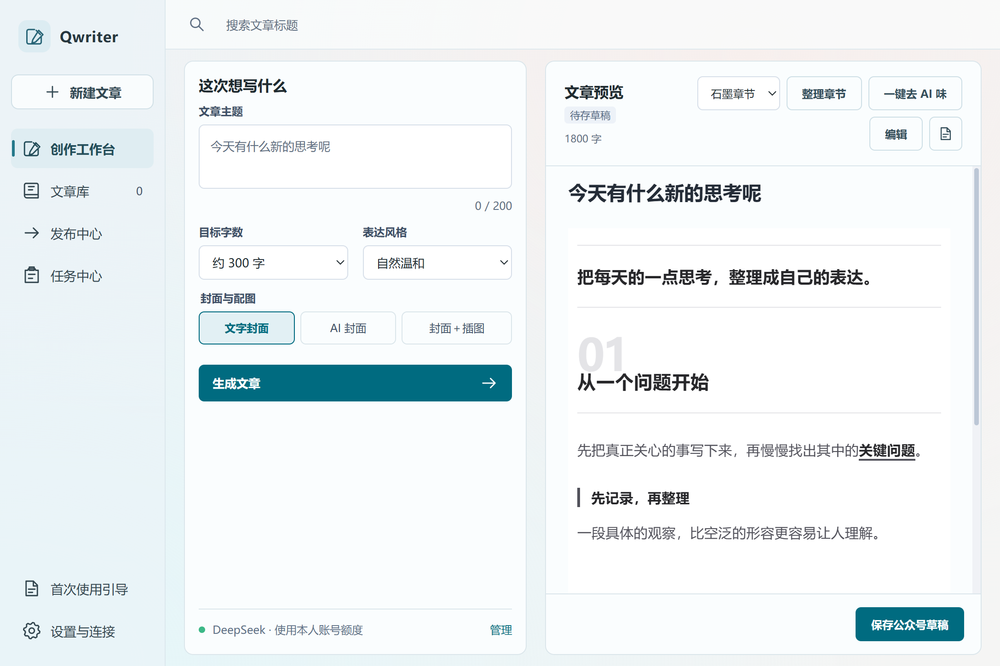
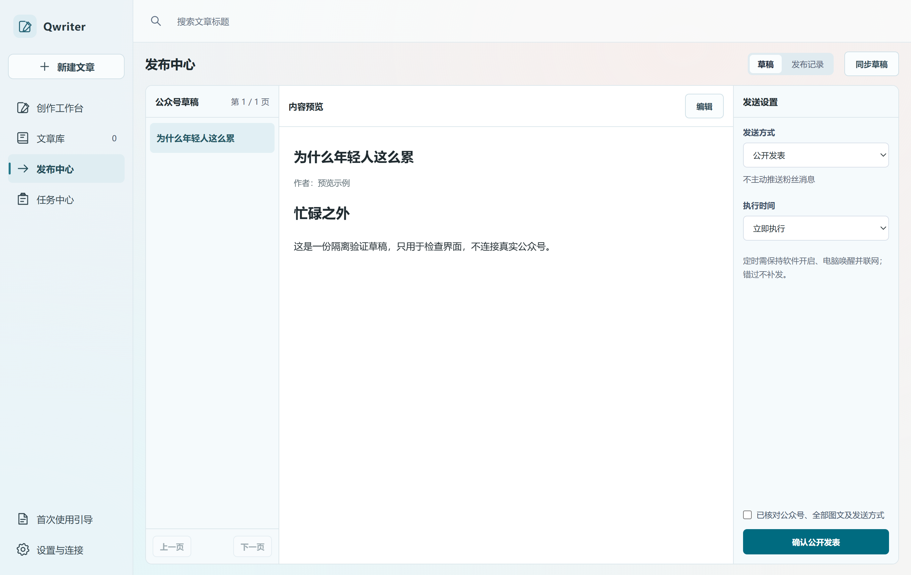

<p align="center"></p>

# Qwriter · 微信公众号 AI 写作与排版工具

**从一个选题，到公众号草稿，在桌面完成。**

输入主题，用本人 WorkBuddy / DeepSeek 额度生成文章与配图，完成排版、编辑、草稿同步和发布管理。把公众号创作中重复的操作，收进一个 Windows 工作台。

[](https://github.com/qis98/Qwriter/releases/latest)
[](https://github.com/qis98/Qwriter/releases/latest)
[](LICENSE)

### 下载即用

**[下载 Windows 安装包 · v1.0.0](https://github.com/qis98/Qwriter/releases/download/v1.0.0/Qwriter-Setup-1.0.0-x64.exe)** · [查看最新版本](https://github.com/qis98/Qwriter/releases/latest) · [首次配置指南](docs/GETTING_STARTED.md) · [反馈问题](https://github.com/qis98/Qwriter/issues)

普通用户下载 `.exe` 安装即可，无需安装 Python、Node.js、Go 或 Codex。GitHub 的 **Source code (zip / tar.gz)** 是源码，不是安装包。



*界面示例使用演示数据。模型生成与公众号操作需要登录和配置本人账号。*

## 能做什么

| 环节 | 功能 |
| --- | --- |
| AI 写作 | 主题、语气与目标字数；支持自定义，留空默认300字，上限12,000字；长文分章节生成并保留中间进度 |
| AI 配图 | 文字封面、AI封面或封面＋插图，使用本人模型额度 |
| 文章排版 | 简洁、石墨章节、微信原生、燕麦随笔、纸刊长文五套样式；章节自动编号；支持常用Markdown结构 |
| 富文本编辑 | 弹窗编辑文字、标题、字体、字号、颜色、对齐；添加、替换、删除图片和更换封面 |
| 公众号草稿 | 生成后自动保存草稿（可关闭）；同步、预览、编辑已有草稿；缓存预览与后台更新 |
| 发布管理 | 公开发表、群发与本机定时任务；执行前核对内容，发布结果保留记录 |
| 本地管理 | 文章库与任务分页、任务清理、发布记录归档、数据目录迁移与文章备份 |
| 账号连接 | 登录本人WorkBuddy账号，可选自动签到；内置微信配置页协助配置公众号 |

**定时任务需保持软件开启、电脑唤醒并联网。公开发表、群发、素材和草稿能力以公众号实际接口权限为准；不同账号可用能力不同。**



## 三步开始

1. **安装并登录模型账号**：下载安装包，选择安装目录，在软件中登录本人 WorkBuddy 账号。
2. **连接公众号**：跟随内置微信配置页，填写 AppID、AppSecret，并将软件提供的实际出口IP追加到 **API IP白名单**。
3. **输入主题，生成与编辑**：选择字数和配图，检查内容后保存草稿；需要发表或群发时，再进入发布中心确认操作。

首次公众号配置仍需要管理员扫码、手动填写开发者信息和维护IP白名单。[查看详细步骤与常见问题 →](docs/GETTING_STARTED.md)

## 使用条件与边界

- **平台**：Windows x64；当前在Windows 11完成验证，其他系统兼容性需自行测试。暂不提供macOS、Linux或手机安装包。
- **模型费用**：使用本人账号的额度和模型平台规则，文章与图片可能分别计费。软件不附送账号，不承诺永久免费或无限额度。
- **模型连接**：当前通过非官方适配接入WorkBuddy，上游变化可能影响可用性。Qwriter不隶属于腾讯、微信或DeepSeek。
- **内容质量**：目标字数为近似值；生成不等于事实核验，目前没有联网研究流程。专业事实、时事、引文和版权内容请自行检查。
- **图片**：现有AI生图可能带平台水印，不提供去水印承诺。
- **安装包**：当前未配置数字签名。请从本仓库Releases下载并可核对SHA-256。

## 本地数据与隐私

新安装的数据默认位于 `安装目录\Qwriter\workspace`，安装目录可自定义。已有用户升级保留原数据目录；可在设置中更换和迁移。

公众号AppSecret由Windows当前用户的系统加密能力保护。WorkBuddy登录凭据存于本机用户配置目录；安装包不包含作者的账号、密钥或文章。模型生成通过网络服务完成，相应内容会发送至模型平台；公众号保存与发布调用微信接口。

[数据位置与隐私说明 →](docs/PRIVACY.md)

## 源码与商业授权

这是**源码公开、版权与商业授权保留**的项目，未采用MIT等通用开源许可证。官方安装包允许下载、安装和使用；源码复用、改造、再分发、改名销售或商业授权，请先联系作者。第三方组件按各自许可证使用。

[授权说明](LICENSE) · [第三方声明](NOTICE.md) · [商业授权咨询](https://github.com/qis98/Qwriter/issues/new?template=commercial.yml)

## 开发与构建

技术栈：Electron + 原生HTML/CSS/JavaScript + Python文章执行器 + 本机模型网关。安装版已打包运行环境，下面步骤仅面向开发者。

在 **PowerShell 7** 中：

```powershell
npm ci
python -m pip install -r requirements-dev.txt
python scripts/prepare_gateway.py
python scripts/build_worker.py
npm test
python -m unittest discover -s worker -p "test_*.py"
$env:PYTHONPATH = "worker"
python -m unittest discover -s tests -p "test_*.py"
npm start
```

构建网关另需安装Git与Go，脚本固定获取上游提交，不使用本机历史验证目录。[完整构建指南 →](docs/BUILDING.md)

## 反馈与关注

欢迎提交可复现的问题、配置体验和排版建议。反馈请附软件版本、Windows版本与复现步骤；不要上传AppSecret、登录令牌或本地配置文件。

如果这个工作流对你有用，可以点 **Star** 方便找回，或通过 **Watch → Releases** 接收版本更新。项目公开发布不保证模型服务与公众号接口始终可用。

## English summary

Qwriter is a Windows desktop AI writing and publishing workflow for WeChat Official Accounts. It combines topic-based article generation, AI illustrations, Markdown typesetting, rich-text editing, draft synchronization and publishing tools. It uses the user's own WorkBuddy / DeepSeek account quota and requires no self-hosted server. Source is available with commercial rights reserved; see [LICENSE](LICENSE).

## 致谢

感谢 [wrokbuddy2api](https://github.com/XCool-603/wrokbuddy2api)、[Raphael Publish](https://github.com/liuxiaopai-ai/raphael-publish)、[Humanizer-zh](https://github.com/op7418/Humanizer-zh)、DOMPurify及其他依赖的作者。NeuraPress用于编辑交互参考。各组件的来源、改编范围和许可证见[第三方声明](NOTICE.md)。
